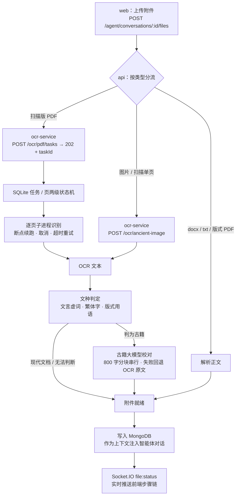

# 古籍扫描件智能识别与校对系统

面向古籍与扫描文档数字化的全栈项目，仓库包含三个服务：`web/`（Vue 3 管理端）、`api/`（Node 智能体服务）、`ocr-service/`（Python OCR 服务）。用户上传图片、扫描版 PDF 或其他文档附件后，系统依次完成 **解析 → OCR → 文种判定 → 大模型校对**，识别结果作为上下文注入智能体对话，实现扫描件直接提问。

## 处理流程



前端把 `processingStage` 还原成步骤链：`上传文件 → OCR 识别 → 文档分类 → 古籍校对`，其中校对节点只在文种判定为古籍时出现，失败时标红但附件仍可继续使用。

## 核心能力：古籍 OCR 链路

- **竖排古籍识别**：整页逆时针旋转 90° 统一为横排 → PaddleOCR 检测与识别 → 检测框坐标反向映射回原图 → 按列坐标从右到左重排，解决通用 OCR 对竖排文本阅读顺序错乱的问题
- **图像预处理**：基于 RGB 通道比例剔除朱印、纸张底色归一化（保留淡墨正文、不做硬二值化）、过滤装订长边框；自动检测合页扫描图中缝，按「右页在前、左页在后」拆分识别后再合并
- **长 PDF 后台任务**：FastAPI + SQLite 实现任务/页两级状态机，上传接口立即返回 taskId；每页 OCR 在独立子进程执行以隔离模型崩溃与显存溢出，支持断点续跑、失败页重试、任务取消与 SSE 进度推送
- **文种判定 + 大模型校对**：基于文言虚词、白话助词、繁体字占比、无标点等特征合成古籍概率，区分古籍 / 现代文档 / 古今混排；仅古籍按 800 字分块串行调用古籍大模型修正错字与断句，模型失败自动降级回 OCR 原文
- **附件即问**：前端以「解析 → OCR → 文种判定 → 校对 → 完成」分步状态链展示实时进度，支持校对失败单独重试与刷新后的状态快照恢复
- **智能体对话**：LangChain + Socket.IO 流式回答、多模型与推理强度切换、工具调用、中断生成与断线重连恢复

> 前端管理端基于 [vue-element-admin](https://github.com/PanJiaChen/vue-element-admin/) 的设计思路重构为 Vue 3 + Composition API + Pinia，不是 `vue-element-admin` 官方项目的直接分支。

## 项目定位

除古籍 OCR 链路外，管理端本身也覆盖了一个贴近真实后台的完整能力集：

- 登录认证与 Token 管理
- 分角色权限控制与动态路由
- 侧边栏 / 顶部导航 / 面包屑 / 标签页布局
- 仪表盘页面与图表展示
- 基于 LangChain 的智能体问答与工具调用，支持前端切换模型和推理强度
- Socket.IO 流式聊天、会话管理、消息持久化，以及中断生成和断线恢复
- 基于 Ant Design X Vue 的聊天界面：Markdown 渲染、代码高亮、一键复制
- 聊天附件上传与解析：PDF / Word / 图片，扫描件和古籍走 OCR 服务
- 错误页、404/401 页面和全局错误处理
- SVG 图标、页面标题、复制和全屏交互
- 多种 Vue 学习示例页面（路由、v-model、图标、心形特效等）

## 技术栈

### 前端（`web`）

- Vue 3：组件化开发与 Composition API
- Vite：开发服务器和生产构建
- TypeScript：类型约束与开发体验
- Vue Router 4：路由管理、嵌套路由、重定向和权限守卫
- Pinia：应用状态管理（登录态、权限、标签页等）
- Ant Design Vue：后台管理系统 UI 组件
- Element Plus：消息提示等辅助能力
- ECharts：图表与数据可视化
- Sass：样式组织与主题变量管理
- Axios：HTTP 请求封装
- `js-cookie`、`nprogress`、`screenfull`：登录态缓存、顶部进度条和全屏能力
- `vite-plugin-svg-icons`：SVG 图标管理
- `normalize.css`：基础样式重置
- `ant-design-x-vue`：AI 聊天界面组件（会话列表、消息气泡、输入框、附件）
- `markdown-it` + `highlight.js`：回复的 Markdown 渲染和代码高亮
- `socket.io-client`：实时聊天连接
- `vue-tsc`：`.vue` 文件的类型检查

### 后端（`api`）

- Node.js + Express：HTTP 服务
- TypeScript：服务端类型约束
- MongoDB + Mongoose：数据持久化
- JSON Web Token：登录认证与鉴权
- bcryptjs：密码哈希
- dotenv：环境变量管理
- cors：跨域支持
- Socket.IO：实时通信
- LangChain + OpenAI 兼容接口：智能体编排、流式输出和工具调用（统一走 Responses API）
- pino：结构化日志
- tsx：TypeScript 开发和脚本执行

### OCR 服务（`ocr-service`）

- Python + FastAPI + PaddleOCR：普通图片、古籍竖排图片和可恢复的 PDF 后台 OCR 任务
- 启动方式和配置见 [ocr-service/README.md](ocr-service/README.md)

## 项目结构

```text
apps/
├─ web/                         # Vue 3 前端
│  ├─ src/
│  │  ├─ api/                   # 接口请求
│  │  ├─ assets/                # 静态资源（图片、图标等）
│  │  ├─ components/            # 通用组件
│  │  ├─ directive/             # 自定义指令
│  │  ├─ icons/                 # SVG 图标注册
│  │  ├─ layout/                # 布局组件（侧边栏、导航栏、标签页等）
│  │  ├─ router/                # 路由配置与权限控制入口
│  │  ├─ stores/                # Pinia 状态（auth / permission / tagsView）
│  │  ├─ styles/                # 全局样式与 SCSS 变量
│  │  ├─ utils/                 # Auth、Axios、Socket、校验和标题工具
│  │  └─ views/                 # 页面视图与学习示例
│  │     └─ agent/              # 智能体聊天（newIndex.vue 为当前页面，components/ 下为头部、消息区、输入框等）
│  ├─ index.html
│  ├─ package.json
│  ├─ tsconfig.json
│  └─ vite.config.ts
├─ api/                         # Express 后端
│  ├─ src/
│  │  ├─ config/                # 数据库配置
│  │  ├─ middleware/            # 鉴权中间件
│  │  ├─ models/                # Mongoose 模型
│  │  ├─ routes/                # API 路由（agent/ 下按会话、消息、文件、工具调用拆分）
│  │  ├─ agent/                 # LangChain 智能体、模型、工具和进行中生成的登记
│  │  ├─ services/              # 文档解析、OCR / 古籍校对客户端、附件处理流程
│  │  ├─ socket/                # Socket.IO 鉴权、事件和类型
│  │  ├─ scripts/               # seed 脚本
│  │  ├─ types/                 # 类型声明
│  │  ├─ server.ts
│  │  └─ ...
│  ├─ uploads/                  # 聊天附件本地存储
│  ├─ package.json
│  └─ tsconfig.json
├─ ocr-service/                 # FastAPI OCR 服务（Python）
├─ README.md
└─ 面试题.md
```

## 环境要求

- Node.js 18+
- npm 9+
- MongoDB 6+（本地或远程实例）
- Python 3.11 + GPU 版 PaddlePaddle + PaddleOCR（仅启用 OCR 服务时需要）

## 安装

在项目根目录执行：

```bash
cd web
npm install

cd ../api
npm install
```

启用 OCR 服务时还需要安装 Python 依赖（在 `ocr-service` 目录执行，路径换成自己的 Python 解释器）：

```powershell
cd ../ocr-service
powershell -ExecutionPolicy Bypass -File scripts/install_gpu.ps1 <你的 python.exe 路径>
```

> 该脚本安装 GPU 版 PaddlePaddle。若直接 `pip install -r requirements.txt`，会退化成 CPU 版，识别长 PDF 会非常慢。

## 配置环境变量

在 `api` 目录创建 `.env` 文件：

```env
PORT=3000
MONGODB_URI=mongodb://127.0.0.1:27017/quiz
JWT_SECRET=change-me
SEED_ADMIN_USERNAME=admin
SEED_ADMIN_PASSWORD=admin123
OPENAI_API_KEY=your-api-key
OPENAI_BASE_URL=https://your-openai-compatible-endpoint/v1

# 附件 OCR（可选，不上传扫描件/图片可不配）
OCR_BASE_URL=http://127.0.0.1:8001

# 古籍 OCR 结果校对（可选）
XUNZI_BASE_URL=http://127.0.0.1:8000/v1
XUNZI_API_KEY=your-xunzi-api-key
XUNZI_MODEL=Xunzi-Qwen1.5-7B_chat
```

校对模型只要求 OpenAI 兼容的 `/chat/completions` 接口，不限定具体模型，可以按手头资源替换：

```env
# 本地 Ollama（模型名换成 ollama list 里已有的）
XUNZI_BASE_URL=http://127.0.0.1:11434/v1
XUNZI_API_KEY=ollama
XUNZI_MODEL=qwen3:8b

# 或云端 API（例如 DeepSeek）
XUNZI_BASE_URL=https://api.deepseek.com/v1
XUNZI_API_KEY=sk-你的-key
XUNZI_MODEL=deepseek-chat
```

模型和推理强度由前端聊天输入框里的选择器决定，随每条消息发送给后端，后端按白名单校验，不在白名单内的回退到 `gpt-5.6-sol`。新增模型时需要同时修改前端 `ModelSelector.vue` 和后端 `socket/handlers.ts` 里的 `ALLOWED_MODELS`。

`OPENAI_BASE_URL` 需要填写 OpenAI 兼容服务的接口地址，通常以 `/v1` 结尾；如果使用官方 OpenAI 接口，可配置为 `https://api.openai.com/v1`。也可以使用 Windows 用户级或系统级环境变量，但修改后需要重新打开终端或 IDE，确保 Node.js 进程能够读取到新变量。

请勿将包含真实密钥、数据库密码或生产配置的 `.env` 文件提交到 Git。

## 启动项目

建议先启动 MongoDB，再依次启动后端和前端。

```bash
# 终端 1：初始化管理员账号（可选，但推荐）
cd api
npm run seed

# 终端 2：启动后端
cd api
npm run dev
```

```bash
# 终端 3：启动前端
cd web
npm run dev
```

```bash
# 终端 4：启动 OCR 服务（可选，上传扫描件 / 图片 / 古籍 PDF 时才需要）
cd ocr-service
python -m uvicorn app.main:app --host 127.0.0.1 --port 8001
```

> 这里的 `python` 必须是装好 PaddleOCR 的那个解释器：先 `conda activate <环境名>` 再执行，或直接写成该环境 `python.exe` 的绝对路径。默认环境的 python 通常没有 paddle，会报 `ModuleNotFoundError`。

> OCR 服务不要加 `--reload`，也不要开多个 worker：文件变化触发的进程重启会中断正在进行的 Paddle 原生推理，多 worker 则会并发抢显存。

访问地址：

- 前端：<http://localhost:5173>
- 后端：`http://localhost:3000`
- OCR 服务：<http://127.0.0.1:8001/docs>

登录后可以在前端“智能体”页面创建会话并发送消息。智能体通过 Socket.IO 返回流式文本，并将会话和消息保存到 MongoDB；询问当前日期、时间、数学计算或自己的账号信息时，会分别调用 `get_current_time`、`calculate`、`get_current_user` 工具。

需要识别扫描版 PDF 或图片附件时，另外启动 `ocr-service`，步骤见 [ocr-service/README.md](ocr-service/README.md)。

类型检查、生产构建与预览：

```bash
cd web
npm run type-check   # vue-tsc 检查 .ts 和 .vue 文件
npm run build
npm run preview
```

## 默认登录信息

项目已支持登录认证，并且后端会在必要时自动创建管理员账户。默认的演示账号如下：

```text
用户名：admin
密码：admin123
```

如果你需要更稳定的演示环境，也可以先执行：

```bash
cd api
npm run seed
```

然后使用上述账号登录。

## 主要接口

后端接口默认挂载在 `http://localhost:3000/api`，除登录接口外均需要在请求头中携带 JWT：

```text
POST /auth/login                         登录并获取 Token
GET  /auth/me                            获取当前用户
GET  /auth/info                          获取用户信息和角色
GET    /agent/conversations                            查询当前用户的会话（支持 ?keyword= 搜索）
POST   /agent/conversations                            创建智能体会话
PATCH  /agent/conversations/:id                        修改会话标题
DELETE /agent/conversations/:id                        删除会话
GET    /agent/conversations/:id/messages               查询会话历史消息
GET    /agent/conversations/:id/tool-calls             查询会话的工具调用记录
POST   /agent/conversations/:id/files                  上传聊天附件
GET    /agent/conversations/:id/files/:fileId          查询附件解析状态
POST   /agent/conversations/:id/files/:fileId/retry    重新解析附件
POST   /agent/conversations/:id/files/:fileId/cancel   取消附件 OCR 任务
```

智能体实时通信使用 Socket.IO，连接地址为 `http://localhost:3000`，握手时通过 `auth.token` 传入登录 Token。加入房间前服务端会校验会话归属。

客户端发送：

```text
chat:join       加入会话房间
chat:leave      离开会话房间
chat:send       发送消息（可带 fileIds、modelName、reasoningEffort）
chat:cancel     停止当前回复，已生成的部分会保留
chat:resume     刷新/重连/切回会话后，重新加入房间并获取进行中回复的快照
```

服务端推送：

```text
agent:delta       流式文本片段（带递增 sequence，done 时给出 completed / cancelled）
agent:tool-start  工具开始执行
agent:tool-end    工具执行完成
agent:error       智能体调用错误
file:status       附件解析进度
```

中断和恢复依赖进程内存记录进行中的生成，只适用于单实例部署；后端重启时进行中的回复会丢失。

## 学习内容

当前代码重点覆盖：

- Vue 3 `<script setup>`、`ref`、`computed`、生命周期和自定义指令
- TypeScript 在 Vue 组件、路由、Pinia 与 Express 中的类型设计
- Vue Router 4 的嵌套路由、动态参数、重定向、404/401 和路由守卫
- Pinia 状态拆分：权限、认证、标签页、错误日志等
- 管理后台常见布局：Sidebar、Navbar、Breadcrumb、TagsView、AppMain
- 权限控制：角色判断、动态菜单生成和路由挂载
- 管理后台功能：图表、全屏、页面标题、SVG 图标、复制功能
- Express + JWT + MongoDB 的登录接口、鉴权中间件与数据模型
- LangChain 智能体、OpenAI 兼容模型配置、实时工具调用和流式输出
- Socket.IO 鉴权、会话房间、消息持久化与前端增量渲染
- AbortController 中断生成，按序号去重的断线恢复
- Markdown 安全渲染（禁用原始 HTML 防 XSS）与代码高亮
- Vue 2 到 Vue 3 的组件、事件和模板语法迁移思路
- Vite 别名、SVG 图标和 Sass 工程化配置

## Git 提交规范

提交信息建议遵循 Conventional Commits：

```text
<type>(<scope>): <description>
```

常用类型：

- `feat`：新增功能
- `fix`：修复问题
- `refactor`：重构，不改变外部行为
- `docs`：文档变更
- `style`：格式或样式调整
- `test`：测试相关
- `chore`：构建、依赖或工具变更

示例：

```text
feat(web): add permission route guard
fix(api): handle invalid login credentials
docs: update local development guide
```

建议使用小而清晰的提交，每次提交只完成一个逻辑变更；提交前至少执行前端类型检查和生产构建。

## 参考项目

- [vue-element-admin](https://github.com/PanJiaChen/vue-element-admin/)：后台管理系统实践参考
- [Vue.js](https://vuejs.org/)
- [Vite](https://vitejs.dev/)
- [Pinia](https://pinia.vuejs.org/)
- [Vue Router](https://router.vuejs.org/)
- [Ant Design Vue](https://antdv.com/)
- [Ant Design X Vue](https://github.com/wzc520pyfm/ant-design-x-vue)
- [LangChain.js](https://js.langchain.com/)

## 免责声明

本项目仅用于学习和技术验证。代码、目录结构和交互设计参考了开源项目，但已根据 Vue 3 学习目标进行调整和重构。使用时请遵守相关开源项目的许可证要求。
